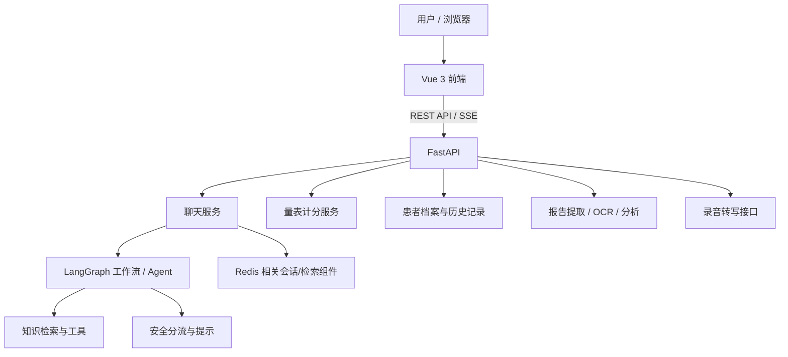

<div align="center">

# PsyConsult · 心晴社区

**面向心理健康科普、量表筛查与测评报告辅助解读的 Web 原型**

以多智能体工作流、知识检索和结构化档案为基础，探索更清晰、更可追溯的心理健康信息服务体验。

</div>

> **重要声明**：PsyConsult 是开发原型，不是临床诊断系统。量表结果和报告解读仅用于筛查、科普与沟通辅助，不能替代专业人员评估、诊断或治疗。项目尚未完成临床有效性验证、监管合规验证或生产级安全评估。

## 功能概览

| 模块 | 功能 |
|---|---|
| 心理健康问答 | 普通问答、连续对话、SSE 流式输出 |
| 安全支持 | 对部分高风险表达进行安全分流和求助提示 |
| 心理健康自评 | PHQ-9、GAD-7 计分及筛查用途说明 |
| 患者档案 | 基本资料、量表结果、历史记录、报告与分析记录 |
| 录音转文字 | 浏览器录音与后端转录接口 |
| 测评报告分析 | 支持 PDF、DOCX、PNG、JPG/JPEG；文本提取、OCR 与结构化解读 |
| 报告归档 | 将报告及分析记录关联到所选患者档案 |

## 技术栈

- **前端**：Vue 3、TypeScript、Vite
- **后端 API**：Python、FastAPI
- **智能体工作流**：LangChain / LangGraph 相关组件
- **检索与会话状态**：项目中的向量检索工具、Redis 相关组件
- **文档处理**：PDF 文本提取、扫描 PDF 处理、图片 OCR、DOCX 文档处理
- **测试**：pytest、Vue TypeScript 检查与前端构建

> 具体依赖版本和环境变量以仓库中的依赖文件及 `app/app_config/settings.py` 为准。请勿将真实 API Key、密码、患者资料或本地 `.env` 文件提交到 Git。

## 系统架构



## 项目结构

```text
.
├── agent/                  # 智能体、工作流、工具与相关测试
├── app/                    # FastAPI 应用、路由、服务、Schema 与测试
├── front/clinical_cds/     # Vue 3 + TypeScript 前端
├── docker/                 # Docker 相关文件（使用前请核对配置）
├── learn/                  # 项目学习与开发说明
├── PsyConsult-community-kb-v1/ # 社区心理健康知识库材料
└── README.md
```

## 本地运行

### 1. 环境准备

建议使用 Python 3.12、Node.js 与 npm。项目还可能需要 Redis、模型服务/API 凭据及向量检索相关配置。

先检查项目配置和依赖文件：

```bash
# 在项目根目录执行
find . -maxdepth 3 \( -name "requirements*.txt" -o -name "pyproject.toml" -o -name ".env.example" \) -print
```

不要把真实密钥写进 README、代码或公开提交。若没有 `.env.example`，请根据 `app/app_config/settings.py` 和实际服务配置建立本地环境变量；不要把本地 `.env` 上传到 GitHub。

### 2. 安装后端依赖

在已经配置好项目所需环境变量和服务的前提下：

```bash
conda activate psyconsult
cd /path/to/PsyConsult

# 先确认该文件包含当前应用需要的依赖
python -m pip install -r agent/requirements.txt
```

如果项目依赖被拆分在多个 requirements 文件中，请按实际文件分别安装。首次启动前，确认 Redis 和模型服务可以访问。

### 3. 启动后端

```bash
conda activate psyconsult
cd /path/to/PsyConsult

python -m uvicorn app.app_main:app \
  --app-dir "$PWD" \
  --host 127.0.0.1 \
  --port 5000
```

检查 API 文档是否可访问：

- OpenAPI JSON：`http://127.0.0.1:5000/openapi.json`
- Swagger UI：`http://127.0.0.1:5000/docs`

### 4. 启动前端

新开一个终端：

```bash
cd /path/to/PsyConsult/front/clinical_cds
npm install
npm run dev
```

按 Vite 在终端打印的本地地址打开网页。开发环境的 `/api` 代理配置请以 `front/clinical_cds/vite.config.ts` 为准。

### 5. 构建前端

```bash
cd /path/to/PsyConsult/front/clinical_cds
npm run build
```

## 主要接口

以下为开发过程中核对过的接口示例；完整接口以运行中的 `/openapi.json` 为准。

| 接口 | 用途 |
|---|---|
| `POST /api/chat/report-analysis` | 在聊天场景上传并分析测评报告 |
| `GET /api/patients` | 查询患者档案列表 |
| `POST /api/patients` | 创建患者档案 |
| `GET/PATCH/DELETE /api/patients/{patient_id}` | 查看、更新或删除患者档案 |
| `GET/POST /api/patients/{patient_id}/assessments` | 查询或保存量表结果 |
| `GET /api/patients/{patient_id}/history` | 查询患者历史记录 |
| `GET/POST /api/patients/{patient_id}/reports` | 查询或归档报告 |
| `POST /api/patients/{patient_id}/reports/{report_id}/analyze` | 对已归档报告执行分析 |

## 测试

在项目根目录执行：

```bash
conda activate psyconsult
python -m pytest -q app/test agent/test
```

前端类型检查与构建：

```bash
cd front/clinical_cds
npm run build
```

开发过程曾记录以下结果（**不是当前仓库版本的自动 CI 保证**）：

- 后端回归测试：82 passed，另有一条 `langchain-community` 弃用警告。
- 端到端 API 冒烟测试：12/12 项通过。
- 安全边界测试：8/8 项通过。
- 报告分析相关的 `app/test` 曾显示 29 passed。
- 前端构建曾成功完成，但有第三方注释与 bundle 体积警告。

每次修改代码后，请在当前提交版本重新运行测试，并记录实际输出。

## 安全、隐私与适用边界

- 不要使用真实患者资料进行公开演示；演示时优先使用明确标注的虚构数据。
- 不要提交 `.env`、访问令牌、API Key、数据库、录音、上传报告或运行日志。
- PHQ-9 / GAD-7 结果属于筛查信息，不应单独用于诊断或决定治疗。
- OCR 可能误识别分数、日期、否定词或量表答案，结果需要人工核对。
- 安全提示与自动化测试不能证明系统具备危机评估能力，也不能替代当地急救或专业服务。
- 发布前应核对知识库、第三方文档和数据集的版权、许可及再分发条件。
- 当前报告归档流程可能重复触发模型分析，因此归档耗时可能较长。
- 在用于真实场景前，需要进一步完成身份认证、访问控制、审计、数据加密、备份恢复、威胁建模和合规评估。

## 项目状态

当前定位：**功能验证与演示原型**。

已实现主要业务流程，但仍需完善部署文档、配置模板、截图展示、权限与隐私保护、自动化 CI，以及报告归档性能。

## 演示与文档

- [项目功能与架构说明](docs/PROJECT_OVERVIEW.md)
- [演示流程建议](docs/DEMO_SCRIPT.md)
- [测试与发布检查](docs/TESTING.md)

## 许可

本仓库暂未在本 README 中声明开源许可证。公开使用或再分发前，请由项目维护者确认代码、知识库和第三方材料的授权，并选择合适的许可证。
