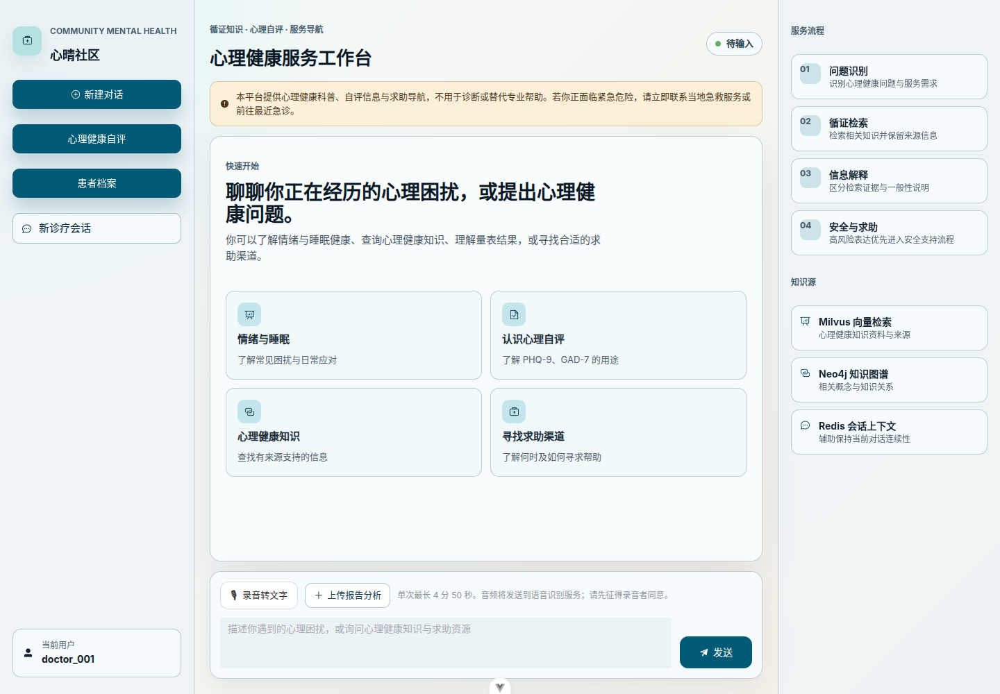
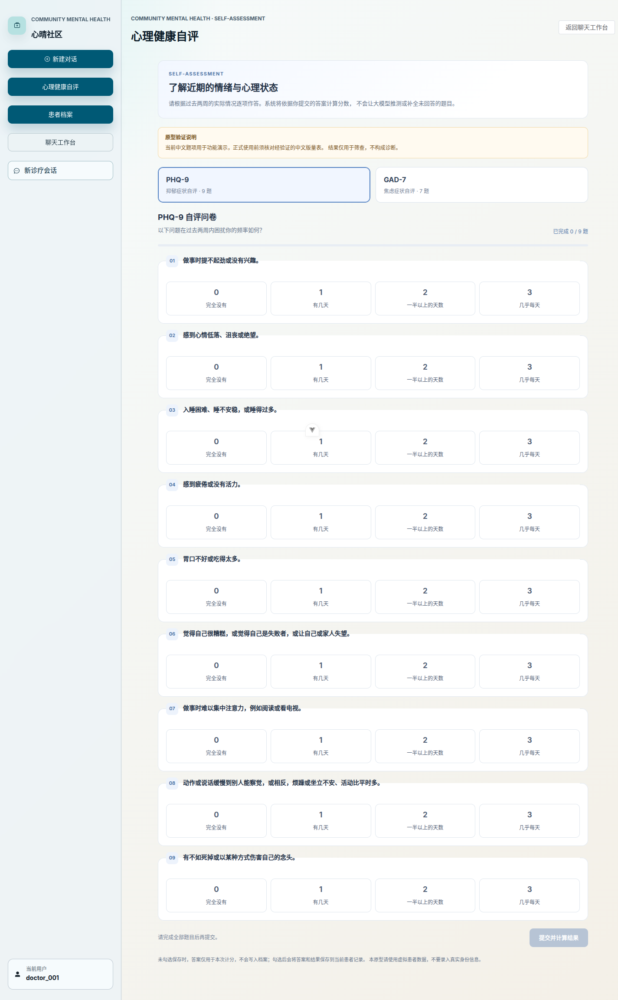
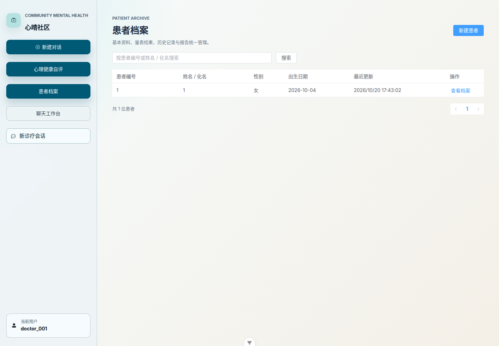
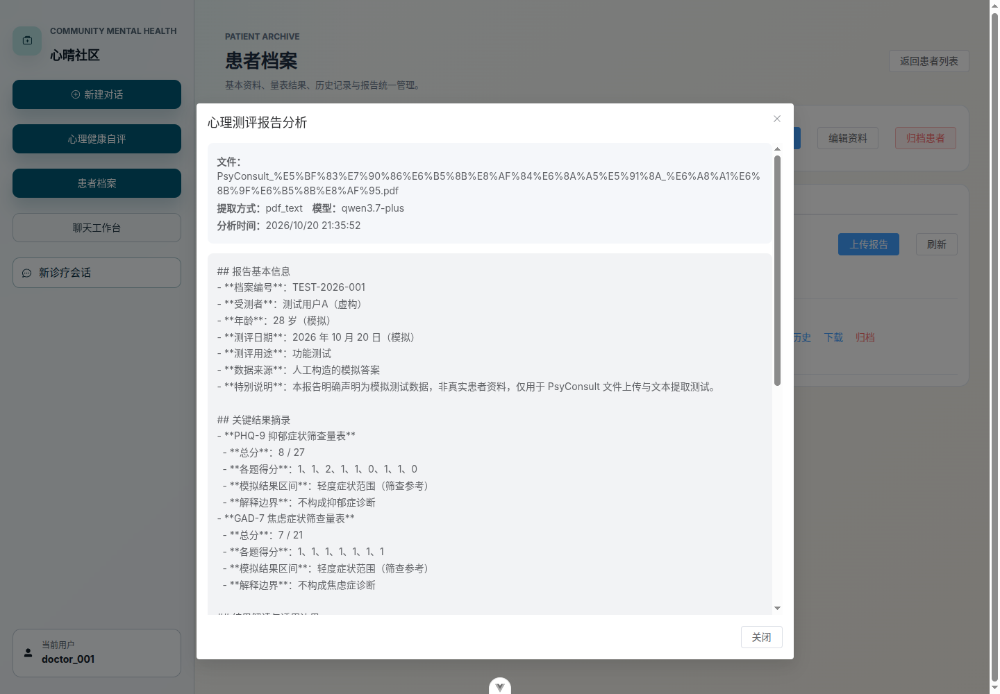
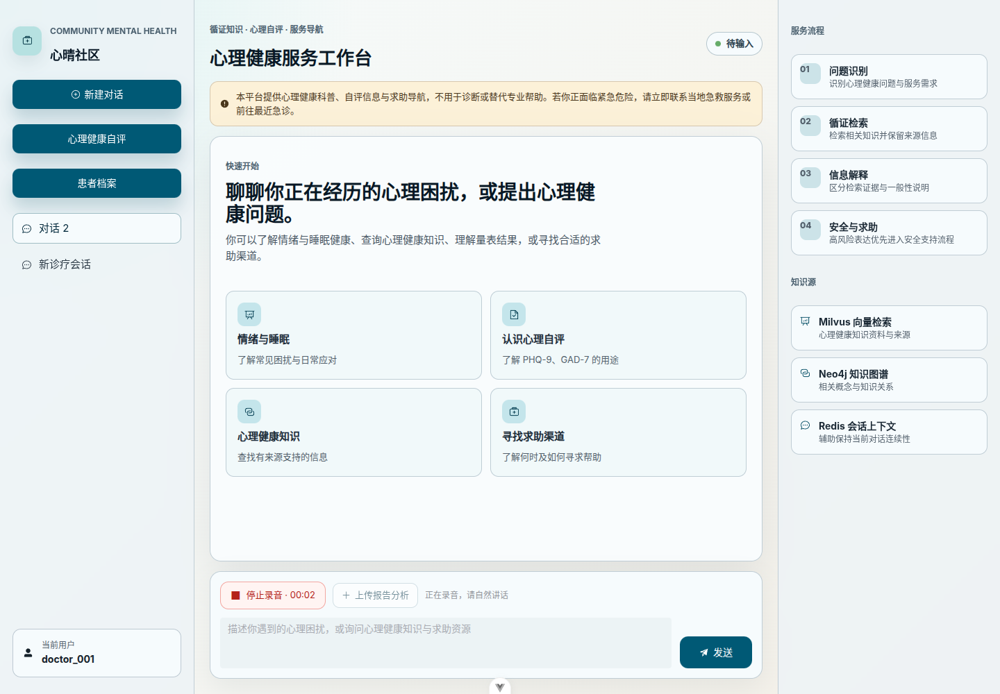

# PsyConsult｜心晴社区

**面向心理健康科普、量表筛查、患者档案与心理测评报告辅助解读的 Web 原型。**

PsyConsult 将对话问答、心理健康自评、患者档案、录音转写和报告分析整合到一个 Web 工作台中，探索更完整的心理健康信息服务流程。

> **重要声明**：PsyConsult 是开发与演示原型，不是临床诊断系统。量表分数和模型生成的报告解读不能单独用于诊断或治疗决策；系统尚未完成临床有效性验证、监管合规验证或生产级安全评估。请勿在公开演示或未经授权的部署中使用真实患者资料。

## 功能概览

| 模块 | 当前功能 |
|---|---|
| 对话问答 | 多轮问答、SSE 流式输出 |
| 安全支持 | 对部分高风险表达进行安全分流，并提供专业求助提示 |
| 心理健康自评 | PHQ-9、GAD-7 计分及筛查用途说明 |
| 患者档案 | 基本资料、量表结果、历史记录、报告管理 |
| 录音转写 | 浏览器录音并调用后端转写接口 |
| 测评报告分析 | 支持 PDF、DOCX、PNG、JPG/JPEG；提取文本/OCR 后生成结构化辅助解读 |
| 报告归档 | 将报告与分析记录关联至所选患者档案 |

## 系统截图

截图应从本地实际运行的 PsyConsult 页面获取；本仓库不使用仿制图冒充真实系统截图。启动前后端并准备虚构测试数据后，运行：

```bash
python -m pip install playwright
python -m playwright install chromium
python tools/capture_screenshots.py --url http://127.0.0.1:5173
```

脚本会打开浏览器，提示你切换到对应功能页面后截取真实画面，并将截图保存到 `docs/screenshots/`，同时更新本节。截图前请确认页面中没有真实姓名、患者 ID、报告原文、访问令牌或其他个人信息。

<!-- SCREENSHOTS_START -->
### 聊天主界面



### 心理健康自评



### 患者档案



### 心理测评报告分析



### 录音转写


<!-- SCREENSHOTS_END -->

## 技术栈

- **前端**：Vue 3、TypeScript、Vite
- **后端**：Python、FastAPI
- **智能体与工作流**：LangChain / LangGraph 相关组件
- **会话与检索基础设施**：Redis 及项目配置的向量检索组件
- **文档处理**：PDF 文本提取、扫描 PDF 处理、图片 OCR、DOCX 文档处理
- **测试**：pytest、前端 TypeScript 检查与 Vite 构建

具体依赖和必需环境变量以仓库中的 `agent/requirements.txt`、`app/app_config/settings.py`、`agent/config/` 等配置为准。

## 项目结构

```text
.
├── agent/                       # Agent、工作流、工具与相关测试
├── app/                         # FastAPI 应用、路由、服务、Schema 与测试
├── front/clinical_cds/          # Vue 3 + TypeScript 前端
├── docker/                      # 本地基础服务配置（如当前分支包含）
├── learn/                       # 学习与开发文档
├── PsyConsult-community-kb-v1/  # 社区心理健康知识库材料（如当前分支包含）
├── docs/                        # 安装、功能报告、测试与截图
└── tools/                       # 截图与公开发布前自查脚本
```

## 快速开始

详细步骤见 [安装与运行说明](docs/INSTALL.md)。

### 1. 准备依赖

建议使用 Python 3.12、Node.js/npm、Docker Compose（若使用仓库提供的基础服务），并准备项目所需的模型服务/API 凭据。

```bash
conda activate psyconsult
cd /path/to/PsyConsult
python -m pip install -r agent/requirements.txt
```

如没有名为 `psyconsult` 的 Conda 环境，请先创建环境。请先阅读配置代码，确认当前分支所需环境变量；不要将真实 `.env` 文件、API Key 或 Token 提交到 Git。

### 2. 启动后端

```bash
conda activate psyconsult
cd /path/to/PsyConsult

python -m uvicorn app.app_main:app \
  --app-dir "$PWD" \
  --host 127.0.0.1 \
  --port 5000
```

- OpenAPI：`http://127.0.0.1:5000/openapi.json`
- Swagger UI：`http://127.0.0.1:5000/docs`

### 3. 启动前端

新开终端：

```bash
cd /path/to/PsyConsult/front/clinical_cds
npm install
npm run dev
```

请使用 Vite 终端实际打印的地址访问网页，默认通常为 `http://127.0.0.1:5173`。

### 4. 运行测试

```bash
# 项目根目录
conda activate psyconsult
python -m pytest -q app/test agent/test

# 前端构建与类型检查
cd front/clinical_cds
npm run build
```

历史测试记录和当前已知限制见 [功能报告与测试结果](docs/PROJECT_REPORT.md)。历史通过不代表当前工作区无需重新测试。

## 常用接口

接口路径以当前运行版本的 `/openapi.json` 为准。开发过程中核对过的报告和档案接口包括：

| 接口 | 用途 |
|---|---|
| `POST /api/chat/report-analysis` | 在聊天场景上传并分析心理测评报告 |
| `GET /api/patients`、`POST /api/patients` | 查询或创建患者档案 |
| `GET/PATCH/DELETE /api/patients/{patient_id}` | 查看、更新或删除患者档案 |
| `GET/POST /api/patients/{patient_id}/assessments` | 查询或保存量表结果 |
| `GET /api/patients/{patient_id}/history` | 查询患者历史记录 |
| `GET/POST /api/patients/{patient_id}/reports` | 查询或归档报告 |
| `POST /api/patients/{patient_id}/reports/{report_id}/analyze` | 分析已归档报告 |

## 安全与隐私

- 不要提交 `.env`、API Key、Token、密码、私钥、数据库、运行日志、真实患者资料、录音或上传报告。
- 演示时只使用明确标注的虚构测试数据，并在截图前检查页面内容。
- OCR 可能误识别分数、日期、否定词或答案，结果必须人工核对。
- PHQ-9 / GAD-7 是筛查工具，不能单独用于诊断。
- 公开知识库前，应逐项确认原始材料的版权、许可、署名和再分发条件；仅列出来源 URL 不等于获得复制授权。
- 在真实场景使用前，需要进一步评估身份认证、患者级访问控制、审计、数据加密、备份恢复和适用法规。

公开发布前建议执行：

```bash
python tools/audit_public_release.py
```

然后按 [公开发布安全与授权检查表](docs/SECURITY_REVIEW.md) 手工核对。该脚本是辅助筛查工具，不是完整安全审计。

## 文档

- [安装与运行说明](docs/INSTALL.md)
- [功能报告与测试结果](docs/PROJECT_REPORT.md)
- [公开发布安全与授权检查表](docs/SECURITY_REVIEW.md)

## 许可证

当前 README 不声明本项目整体的开源许可证。发布者应先确认自有代码、第三方依赖、知识库材料、数据集及文档的授权，再选择合适的许可证。未核实的第三方材料不应默认按本项目许可证重新授权。
