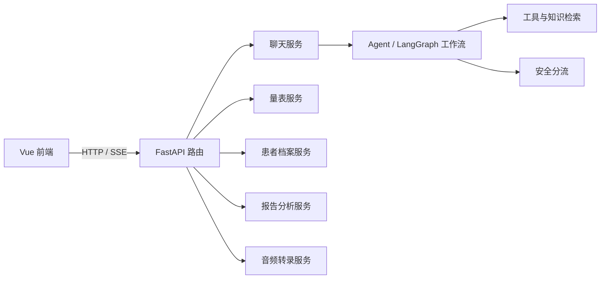

# PsyConsult 项目功能与架构说明

## 1. 项目定位

PsyConsult（心晴社区）是一个面向心理健康科普、量表筛查、患者档案管理和心理测评报告辅助解读的 Web 开发原型。它用于验证从用户交互、后端工作流、文档处理到档案归档的产品流程，不应描述为临床诊断或治疗系统。

## 2. 功能模块

### 2.1 对话问答与 SSE

- 提供聊天接口和流式响应。
- 支持连续对话。
- 通过工作流和工具完成请求处理。
- 对部分高风险表达进行安全分流，并提供求助提示。

### 2.2 心理健康自评

- 支持 PHQ-9 和 GAD-7 量表计分。
- 对答案数量和输入值进行校验。
- 结果应明确标注为筛查用途，不能单独用于诊断。
- PHQ-9 第九题非零时返回进一步评估和紧急求助提示。

### 2.3 患者档案

- 基本资料管理。
- 量表结果记录。
- 历史记录查询。
- 报告文件和分析记录管理。
- 支持报告与患者档案关联。

### 2.4 录音转文字

- 前端录音。
- 通过后端转录接口提交音频。
- 转写结果可用于后续交互；实际支持的音频格式和时长限制应以当前接口实现为准。

### 2.5 测评报告分析

- 文件类型包括 PDF、DOCX、PNG、JPG/JPEG。
- 文本 PDF 尝试直接提取文本；扫描材料可能使用 OCR。
- 模型输出结构化的结果摘录、解释、缺失字段与适用边界。
- 用户应人工核对 OCR 结果，尤其是分数、否定词、日期和量表答案。
- 报告分析结果可以与患者档案关联保存。

## 3. 高层架构

## 4. 重要接口示例

请以当前服务 `/openapi.json` 为准：

- `POST /api/chat/report-analysis`
- `GET/POST /api/patients`
- `GET/PATCH/DELETE /api/patients/{patient_id}`
- `GET/POST /api/patients/{patient_id}/assessments`
- `GET /api/patients/{patient_id}/history`
- `GET/POST /api/patients/{patient_id}/reports`
- `POST /api/patients/{patient_id}/reports/{report_id}/analyze`

## 5. 已知限制

1. 报告归档可能重复执行模型分析，造成数十秒等待；可考虑复用聊天分析结果。
2. OCR 结果需要人工核对。
3. 现有测试通过不代表临床有效性、危机识别能力或监管合规性已获验证。
4. 公开发布前需补充配置模板、部署验证、身份认证/授权、审计和数据保护方案。
5. 前端构建曾出现第三方依赖注释警告和打包体积警告。

## 6. 适用边界

系统仅用于开发演示、心理健康科普与筛查流程辅助。它不替代专业人员诊断、处方或个体化治疗；如涉及即时危险，应联系当地急救服务或专业危机支持渠道。
